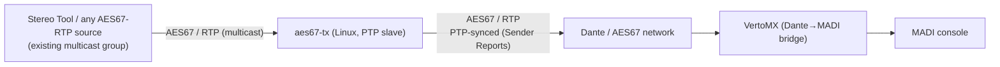

# aes67-tx

[](https://github.com/HansVanEijsden/aes67-tx/actions/workflows/build.yml)
[](https://github.com/HansVanEijsden/aes67-tx/blob/main/LICENSE)

Publish an existing AES67/RTP audio stream as a **PTP-synchronised AES67 (Dante-compatible) source** on Linux.

Many broadcast AES67/Dante receivers (mixers, MADI bridges, Dante Controllers) are strict: a source is only accepted if its RTP timestamps and RTCP **Sender Reports** reference the **PTP clock of the network's grandmaster**. Standard Linux audio tools (GStreamer, ffmpeg, VLC) send RTP on the *system* clock — usually NTP-based and unrelated to the audio-over-IP/PTP domain — so a Dante/AES67 device refuses the stream ("no signal", "no sync", "cannot subscribe: RTP not enabled", …).

`aes67-tx` bridges that gap. It reads an existing AES67/RTP multicast stream and re-publishes it as a new AES67 multicast source whose Sender Reports are timestamped against the machine's **PTP hardware clock (PHC)**, which `ptp4l` slaves to the grandmaster. Because the Sender Reports map the media clock onto the PTP domain clock, an AES67 receiver accepts and locks to the stream.

It is a small, single-file C program with no runtime dependencies beyond a PTP-capable NIC.

> **Operational status:** see [STATUS.md](STATUS.md) for the current production state, decisions, open items and next step.

---

## Typical use case

A broadcast processor (e.g. **Thimeo Stereo Tool**) emits AES67 / LiveWire audio on one multicast group. You want that same audio available on a mixing console (or a Dante→MADI bridge) that only accepts Dante/AES67 on another group / clock domain.

```
Stereo Tool  ── AES67/RTP ──>  [eth0] aes67-tx  ── AES67/RTP (PTP) ──>  [VertoMX]  ── MADI ──>  console
```

The host running `aes67-tx` must be a **PTP slave of the console's grandmaster**.

---

## How it works



- It forwards the RTP **payload bytes unchanged** (no decode/encode). The output format is therefore the same as the input (e.g. `L24/48000/2`).
- It rewrites the RTP header: new SSRC, new sequence number, and — by default — **re-stamps each packet from the PTP clock** (the PHC), so the media clock runs in lockstep with the grandmaster.
- It sends **RTCP Sender Reports** every second. The Sender Report's timestamp is taken from the **PHC** (the NIC's PTP-synchronised hardware clock), so the receiver can lock the media clock to the PTP grandmaster.
- `--keep-ts` instead forwards the source's own RTP timestamps (only sensible if the source already follows the grandmaster).

---

## Requirements

- Linux with a NIC that exposes a **PTP hardware clock** (`/dev/ptpN`, e.g. an Intel I219/V2V, or many server NICs). Verify: `ethtool -T eth0` shows `hardware-receive`/`hardware-raw-clock` and a "Hardware timestamp provider".
- A **PTP grandmaster** on the network (a Dante/AES67 device often fulfils this role).
- The host configured as a **PTP slave** of that grandmaster with `ptp4l` (`/dev/ptp0` then reflects the domain time). See [Setting up the PTP slave](#setting-up-the-ptp-slave).
- **root** privileges at runtime (to open `/dev/ptpN` and join multicast groups).
- `gcc`/`cc` to build.

The host does **not** need to be NTP-synchronised; run `ptp4l` slave and `chrony`/NTP independently (recommended: keep the system clock on NTP and only use the PHC for AES67 timing).

---

## Build

```sh
make
# or
cc -O2 -Wall -Wextra -o aes67-tx aes67-tx.c

sudo make install   # optional: installs to /usr/local/bin/aes67-tx
```

---

## Example: Stereo Tool → MADI console

End-to-end: take **Thimeo Stereo Tool**'s AES67/LiveWire output and make it available on a
mixing console via a Dante→MADI bridge.

1. **Sync the PTP clock** — the host must follow the console's grandmaster. Configure
   `ptp4l` in slave-only mode and confirm `portState = SLAVE` (see
   [Setting up the PTP slave](#setting-up-the-ptp-slave)).

2. **Publish the stream.** Read Stereo Tool's AES67 output and write it to a fresh group:

```sh
sudo ./aes67-tx \
  -A 239.192.19.137 -P 5004 \      # the existing AES67/RTP source
  -a 239.69.100.1   -p 5004 \      # the new AES67 output group
  -f eth0 -v
```

3. **Subscribe in Dante Controller.** Add the matching SDP (see [Example SDP](#example-sdp) /
   `example-sdp.txt`; change `YOUR-HOST-IP`), then subscribe the flow to your device and
   **route it to the MADI output** (via the VertoMX).

4. **Turn the console on.** The VertoMX converts Dante→MADI; with the console running, the
   (delayed) on-air signal appears on the **MADI console**.

> If the receiver refuses the flow ("RTP not enabled on RX device"), enable **AES67** on the
> receiving device — a hardware Dante/AES67 device, not a DVS (Dante-only) host.

---

## Options

```
-a, --output-addr <addr>   output multicast group            (required)
-p, --output-port <port>   output RTP port                   (default 5004)
-A, --input-addr <addr>    input multicast group             (one of the two)
-P, --input-port <port>    input RTP port                    (default 5004)
-S, --sdp <file>           read input addr/port from an SDP file
-k, --ssrc <hex>           output SSRC                       (0 = random)
-t, --pt <n>               output RTP payload type           (default 96)
-l, --ttl <n>              multicast TTL                     (default 8)
-f, --iface <name>         output interface, e.g. eth0
-d, --ptp-device <path>    PTP hardware clock                (default /dev/ptp0)
-r, --sr-interval <sec>    Sender Report interval            (default 1)
-R, --re-stamp             re-stamp RTP timestamps from the PTP clock (default)
-K, --keep-ts              forward the source RTP timestamps instead
-B, --rate <hz>            RTP clock rate for --re-stamp     (default 48000)
-W, --raw                  read raw PCM on stdin instead of an RTP source
-b, --bit <16|24>          PCM bits per sample for --raw      (default 24)
-C, --channels <n>         channels for --raw                 (default 2)
-n, --pkt <frames>         frames per RTP packet for --raw    (default 48 = 1 ms)
-J, --jitter <pkts>        input ring capacity for --raw      (default 32 = 32 ms)
-L, --latency <ms>         target buffer latency for --raw   (default 0 = half of -J)
-v, --verbose              log progress to stderr
-h, --help                 show help
```

### Choosing the input

Use either `-A/-P` (address and port) or `-S <sdp-file>`. An SDP is handy when you have the source's session description (Stereo Tool, RAVENNA, etc.); the `c=` and `m=audio` lines are read.

### Choosing the output timestamp strategy

This is the part that makes or breaks a Dante/AES67 receiver accepting the stream.

- **`--re-stamp` (default):** each RTP packet is timestamped **from the PTP clock (PHC)**. The media clock runs *in lockstep* with the grandmaster, which is exactly what Dante requires. **Use this when the source does not follow the grandmaster** — which is the common case (e.g. Stereo Tool, which uses the *system* clock). Specify the session clock rate with `--rate`.

  **How `--re-stamp` is done matters.** Older builds stamped every packet from a *fresh* `phc_sec()` read; that re-read is not perfectly even (hardware-clock granularity + the PTP servo), so the media clock jittered by several RTP ticks per packet — which a strict receiver plays as a ragged/overdriven "fuzzy" distortion, even though the source content itself was clean. Since v1.4.0, `--re-stamp` **seeds the media clock once from the PHC** and then advances it by the **exact sample count** of each packet. Result: a clean, even media clock (measured RTP-timestamp step `48.00` with *zero* jitter vs a jittery `48.0 ± 3.9` before) that is still PTP-referenced via the Sender Reports. This removed the audible distortion on both a LiveWire (Stereo Tool) source and a decoded network FLAC stream.

  **v1.4.1 — pace against the *PTP* clock rate, not the system clock.** A *free-running* grandmaster (many Dante bridges are class-248, i.e. not PTP timescale, no external word clock) runs a few ppm away from 48 kHz. Advancing the media clock by the plain sample count paces it at the *system* (NTP/MONOTONIC) clock, which drifts a few ppm from the free-running grandmaster. Over a long session this slowly falls behind, so the receiver's jitter buffer under-runs: every audio packet shows *"Late"* and the reported latency climbs (>500 ms after a long run). `aes67-tx` now measures the PTP clock rate (`phc_rate`, PTP seconds per MONOTONIC second) at startup and advances the media clock by `sample_step * phc_rate`, so it stays in lockstep with the grandmaster (no drift, no "Late", flat latency).

- **`--keep-ts`:** forwards the source's own RTP timestamps. Only use this if the source is already PTP-synchronised. If you forward the timestamps of a *non-PTP* source, the media clock does not run in lockstep with the grandmaster: the receiver sees a "latency" (clock offset) that **jumps around on every stream restart**, and a Dante device will show the flow as **connected but muted** (green, no sound). This is a known symptom when a processor like Stereo Tool emits AES67 without slaving to the grandmaster. `aes67-tx` in `--re-stamp` mode re-timestamps from the PHC so the source *is* in lockstep.

### Feeding it a non-RTP source (--raw)

Use `--raw` when your audio is not already on RTP/AES67 — e.g. a network IceCast/FLAC
stream, a file, or a sound card. It reads raw interleaved PCM from **stdin**, packetises it
as AES67 and re-stamps every packet from the PTP clock.

The recommended front-end is Liquidsoap, because it reconnects the HTTP input, decodes
Ogg/FLAC losslessly and can feed `aes67-tx` raw 24-bit PCM without an intermediate file:

```liquidsoap
s = mksafe(input.http("https://radio.example.org/station-flac",
                      max_buffer=0.5, self_sync=false))
output.external(
  %wav(header=false, samplerate=48000, channels=2, samplesize=24),
  "/usr/local/bin/aes67-tx --raw -k 0x6a95A511 -a 239.69.100.2 -p 5004 \
     -f eno1 -b 24 -C 2 -n 48 -J 3072 -L 1000 -t 96 -l 8",
  s, self_sync=true)
```

A pipe from `ffmpeg` works too (ffmpeg scales 16-bit audio to 24-bit automatically):

```sh
ffmpeg -hide_banner -loglevel error -reconnect 1 -reconnect_streamed 1 -reconnect_delay_max 5 \
  -i "https://example.org/station" -vn -f s24le -ar 48000 -ac 2 - \
  | aes67-tx --raw -a 239.69.100.2 -p 5004 -f eth0 -b 24 -C 2 -n 48 -J 3072 -L 1000 -v
```

- `-b 16`/`-b 24` set the PCM width; the AES67 payload becomes `L16`/`L24` accordingly.
- **AES67 L16/L24 are big-endian**; `aes67-tx --raw` byte-swaps the little-endian PCM it
  reads to the big-endian RTP payload automatically.
- **A PCM24 receiver (many Dante bridges) rejects `L16` flows.** If your device is configured
  for 24-bit, output `L24`. When you decode a 16-bit source and write `s24le`, ffmpeg scales
  the 16-bit to 24-bit itself, so no extra gain filter is needed (Liquidsoap's
  `%wav(..., samplesize=24)` does the same).
- `-n 48` = 48 frames/packet (≈1 ms at 48 kHz). Keep the SDP's `a=ptime` in agreement.
- **`-J <N>`** is the input ring *capacity* in packets (default 32 = 32 ms). Use a large
  capacity for an internet source, e.g. `-J 3072` ≈ 3 s or `-J 4096` ≈ 4 s.
- **`-L <ms>`** is the target buffer latency (default 0 = half of the `-J` capacity). This is
  the crucial setting for a non-PTP source: the input clock runs on the remote encoder's
  crystal, which drifts a few ppm against the Dante/PTP grandmaster. A fixed-rate pipe would
  slowly fill (growing latency) or empty (zero-packet hiccups). Since **v1.6.0**, `--raw`
  uses a **32-tap windowed-sinc adaptive resampler**: a slow PI controller watches the ring
  fill and continuously adjusts the resampling ratio to hold it at the `-L` target. The
  output itself is still PTP-paced, so the receiver stays locked and the latency stays flat.
  A target of 1000–1500 ms is a good compromise for an internet feed; raise `-L`/`-J` for a
  more forgiving uplink, lower them for less latency.
- `ffmpeg -reconnect ...` (or Liquidsoap's `input.http`) reconnects over short outages;
  `aes67-tx --raw` exits on upstream EOF so a supervising `systemd` unit (`Restart=always`)
  re-spawns the pipeline for longer drops — together this gives automatic reconnection.
- **`-U <s>`** makes the raw path exit after N seconds of buffer underrun. This covers the
  nasty failure where the decoder/Liquidsoap keeps running but stops delivering PCM: without
  it the sender happily transmits silent zero packets forever, so a packet watchdog sees
  "healthy" traffic. Use `-U 10` for an internet-fed service; systemd then restarts the chain.

### Media-clock PLL, emitter stalls and PTP steps (v1.7.0 / v1.7.1)

The media clock is seeded from the PTP hardware clock once and then advanced by exact sample
counts. An offset between the RTP timestamp and the PHC therefore means one of two things: the
**sender itself fell behind** (a descheduled or busy process, or a receive gap in the relay
path), or the clock really **stepped** (grandmaster reboot, VertoMX/clock reconfiguration,
switch hiccup). A Dante receiver reports either as a "Late" offset and may mute the channel
until it is corrected.

Since **v1.7.1** the sender distinguishes them as far as it can:

- **Stalls up to 100 ms** (`MAX_CATCHUP_S`) are caught up: the sender keeps its emit schedule
  and sends the backlog immediately, so the media clock stays locked to the PHC and the RTP
  timestamps stay continuous. The receiver may flag those packets "Late", but it never sees a
  media-clock jump. (Before v1.7.1 only the schedule was restarted, which left the media clock
  permanently behind the PHC; a quarter of a second later the step detector reported that as a
  "PTP step" and fired a disruptive hard reseed. Diagnosis in October 2026 showed that every
  reseed in production happened while `ptp4l` itself stayed within a few µs and
  `gmTimeBaseIndicator` was 0 — they were local stalls, not grandmaster steps.)
- **A lag beyond 100 ms** is not worth bursting: the media clock is resynchronised in one
  bounded jump and the log says

      media clock resynced (+100.0 ms of 150.3 ms) - emitter stalled longer than 100 ms

- **Small offsets** are slewed out over ~30 s by the PLL (bounded to 500 ppm), so timestamps
  stay continuous.
- **A real PTP step** — or any offset that survives the catch-up — is corrected in place every
  250 packets when the absolute RTP↔PHC difference exceeds **20 ms**:

      media clock off PHC by -9.0 ms - hard reseed (long stall or PTP step)

  The RTP timestamp gets a short discontinuity, but the service, the Liquidsoap input and the
  ASRC buffer keep running; the receiver re-locks within a few packets. This is deliberately an
  in-process correction (no service restart, no stream reconnect). In the relay path the text is
  `...(receive gap/burst or PTP step)`, because the relay clock advances on *received* packets:
  a receive gap leaves it behind the PHC and the following burst leaves it ahead. Anchoring the
  relay clock on the PHC with a small jitter buffer is still an open item (see STATUS.md).
- `--keep-ts` disables the check, because forwarded source timestamps are not necessarily
  PHC-referenced.

`tools/media-clock-stall-test.sh` reproduces the stall cases on a scratch multicast group
(`SIGSTOP`/`SIGCONT` on a private sender and relay) without touching the production flows.

### Output interface

Set `-f <iface>` to the interface that carries the output multicast (the one wired to the Dante/AES67 switch). If omitted, the kernel picks the default route interface.

---

## Setting up the PTP slave

The host must expose a PTP-slaved hardware clock. A minimal, **slave-only** `ptp4l` configuration:

```ini
# /etc/linuxptp/aes67.conf
[global]
domainNumber        0
network_transport    UDPv4
delay_mechanism     E2E
```

Run it in **slave-only** mode so this host never becomes a grandmaster (important — you do not want to corrupt the domain):

```sh
sudo ptp4l -i eth0 -s -f /etc/linuxptp/aes67.conf
```

Check it found and follows the grandmaster:

```sh
pmc -u -b 0 "GET PORT_DATA_SET"      # expect portState = SLAVE
pmc -u -b 0 "GET TIME_STATUS_NP"     # expect gmPresent = true and a small master_offset
```

A ready-to-use systemd unit is in **`ptp4l-aes67.service`** (adjust the interface and PTP device). The host's *system clock* can stay on `chrony`/NTP; the PHC is what matters for AES67.

> **Troubleshooting:** if `ptp4l` stays `UNCALIBRATED`, the grandmaster may only answer **unicast** Sender/Delay requests (a common Dante behaviour). Add `hybrid_e2e 1` to the `[global]` section:
> ```ini
> hybrid_e2e          1
> ```
> This makes the slave send its delay request directly to the grandmaster's address rather than as a multicast request.

---

## Example SDP

The output stream is described by an SDP you paste into the controller. It must match the output **payload type**, **media** (`c=`), **port** (`m=audio`), and **encoding**. For a `L24/48000/2` output:

```sdp
v=0
o=- 1 1 IN IP4 <host-ip>
s=aes67-tx re-publication
c=IN IP4 239.69.100.1
t=0 0
m=audio 5004 RTP/AVP 96
a=rtpmap:96 L24/48000/2
a=ptime:1
a=mediaclk:direct=0
a=ts-refclk:ptp=IEEE1588-2008:<grandmaster-id>:0
```

- Replace `<host-ip>` with the IP of the host running `aes67-tx`.
- Replace the `c=`, `m=audio` and payload type to match your actual output (`-a`, `-p`, `-t`).
- **`a=ts-refclk` is not optional on a Dante/AES67 receiver.** It tells the receiver that the RTP
  media clock is referenced to the PTP grandmaster. Without it the receiver may still show the
  flow, but packets arrive "Late"/"Early" (red latency bars, muted audio) because it has no
  mapping from the RTP timestamps to the Dante clock. Use the grandmaster's clock identity in
  the EUI-64 form `00-1D-C1-FF-FE-01-B0-96` (8 bytes, dashes) followed by the PTP domain
  (`:0` on this network). Get it from the PTP slave:

  ```sh
  pmc -u -b 0 'GET PARENT_DATA_SET' | grep grandmasterIdentity
  # grandmasterIdentity 001dc1.fffe.01b096  ->  00-1D-C1-FF-FE-01-B0-96
  ```

Two ready-made examples are in the repository: `example-sdp-refclk.txt` (with the PTP
reference; use this for Dante) and `example-sdp.txt` (plain, for controllers that do not need
`ts-refclk`).

### Subscribing in Dante Controller

1. **File → External SDP Sessions → Add**, paste the SDP, OK. The source should appear.
2. Select your device (the mixer, the MADI bridge, the DVS host). If a receiver complains **"RTP not enabled on RX device"**, enable **AES67** in that device's config — note that *Dante Virtual Soundcard (DVS)* is Dante-only and does **not** receive AES67; use a hardware Dante/AES67 device instead.
3. Subscribe the new channels and route them to the output, then confirm the flow shows signal/audio.

> **Each SDP needs a unique session ID.** Dante Controller identifies an External SDP Session by the *session id* in the `o=` line (the number after the username, e.g. `o=- 1 1 IN IP4 ...`). If you import a second SDP that uses the same session id, Dante asks *"A session with session ID N already exists. Do you want to replace the existing session?"*. Give every imported SDP its own session id — e.g. use `o=- 1 1 ...`, `o=- 2 1 ...`, `o=- 3 1 ...` for successive sources.

---

## Where the audio ends up

The newly published source is a normal AES67 multicast stream on the output group. You can route it to any AES67/Dante receiver. Because the receiver is typically a hybrid Dante/AES67 network, you normally:

- enable AES67 on the receiving device, and
- subscribe the source from the "External SDP Session" entry, then
- assign that flow to the desired Dante channels / MADI outputs.

---

## Troubleshooting

| Symptom | Likely cause / fix |
|---|---|
| Source appears but subscription is refused, or flow is red | The stream is not PTP-synced. Make sure the host is a PTP slave (`portState = SLAVE`) and Sender Reports are being sent (`tcpdump ... port 5005`). |
| "RTP not enabled on RX device" | Enable AES67 on the receiving device. DVS (Dante Virtual Soundcard) has no AES67 receive — use a hardware Dante/AES67 device. |
| `ptp4l` stuck in `UNCALIBRATED` | The grandmaster only answers unicast delay requests — add `hybrid_e2e 1` (see above). |
| Flow is green but **muted**, or no "playing" speaker; latency value jumps on each restart | The media clock is not in lockstep with the grandmaster — likely because the source's timestamps are forwarded instead of re-stamped, or the SDP lacks `a=ts-refclk`. Use the default **`--re-stamp`** and add the PTP reference (see **Example SDP**). |
| Flow is green but no signal on the mixer | The destination (e.g. a MADI/console output) may be inactive, or the SDP lacks the PTP reference (`a=ts-refclk`). Use `example-sdp-refclk.txt`. |
| Latency bars red / packets **Late** by many ms | SDP has no `a=ts-refclk`, or the sender's media clock is offset from the PHC. Add `ts-refclk`; the sender reseeds automatically (log `media clock off PHC by ... - hard reseed`), otherwise restart the sender service once. |
| No audio data / silence | Check the source multicast is flowing (`tcpdump -i eth0 "udp port 5004"`), that you are using the right interface (`-f`), and that the source is not silent. |
| Sender Report interval too aggressive | `--sr-interval` is in seconds; leave at least 1. |

---

## Real-world examples (two streams)

The repository includes working `systemd` units under `examples/` that publish two channels
simultaneously on one host, each on its own multicast group:

- `examples/aes67-1zwolle-hd.service` — re-publishes a source AES67/RTP stream (a broadcast
  processor / LiveWire) as **L24** AES67 on `239.69.100.1`.
- `examples/aes67-salland1-hd.service` + `examples/liquidsoap-aes67-salland1.liq` — Liquidsoap
  fetches and decodes a network IceCast/FLAC stream, then feeds `aes67-tx --raw` as **L24**
  AES67 on `239.69.100.2`, with adaptive resampling (target 1 s, 3 s ring) so clock drift and
  network jitter never accumulate. The same flow/SSRC/SDP is reused, so an existing Dante
  Controller subscription needs no change.

Each channel uses its own output group and its own SDP: `example-sdp.txt` (L24) and
`example-sdp-salland1.txt` (L24, from a 16-bit source). Install and start them with:

```sh
sudo cp examples/*.service /etc/systemd/system/
sudo systemctl daemon-reload
sudo systemctl enable --now aes67-1zwolle-hd aes67-salland1-hd
```

Both units wait for the PTP slave (`ptp4l-slave-eno1.service`) before starting, so the PTP
clock is ready before the AES67 sources come up.

### Keep the PTP slave healthy across reboots (`ptp-watchdog`)

A strict AES67/Dante receiver requires the source's media clock to reference the PTP
grandmaster. If the grandmaster (often a Dante bridge / VertoMX, a *free-running*
class-248 clock) reboots, its clock resets to an arbitrary value (observed ~4 h off).
`ptp4l` (slave-only) normally re-synchronises, but it can occasionally get stuck holding
the old (wrong) time — and then every AES67 source is off by a large offset until `ptp4l`
is restarted.

The included **`ptp-watchdog`** makes this automatic and fail-safe:

```sh
sudo cp ptp-watchdog.sh  /usr/local/bin/ && sudo chmod +x /usr/local/bin/ptp-watchdog.sh
sudo cp ptp-watchdog.service /etc/systemd/system/
sudo systemctl daemon-reload
sudo systemctl enable --now ptp-watchdog
```

It reads the PTP `TIME_STATUS_NP` every 10 s and restarts `ptp4l-slave-eno1.service` only
when the master is present **and** the clock offset has been wrong (> 1 ms) for ~60 s. It
deliberately does nothing while the master is absent (power off / switch down), so it never
fights a still-booting network. Because `aes67-tx` reads the hardware clock on every packet,
it follows `ptp4l` automatically: once the slave clock is corrected the streams recover
without restarting `aes67-tx`.

For a fully hands-off studio bring-up, set `Restart=always` on `ptp4l` and the `aes67-tx`
units (as in the examples) so every component re-spawns itself after a crash or outage,
and the source flows also wait on `network-online.target`.

### Keep a decoded-network stream producing (`aes67-stream-watchdog`)

A decoder can *hang* on a network/decoder error instead of reconnecting — leaving
`aes67-tx --raw` with an empty pipe and `0` packets out. `systemd Restart=always` only
re-spawns when the process *exits*; a hung Liquidsoap/ffmpeg never exits. The included
**`aes67-stream-watchdog`** fixes that:

```sh
sudo cp aes67-stream-watchdog.sh /usr/local/bin/ && sudo chmod +x /usr/local/bin/aes67-stream-watchdog.sh
sudo cp aes67-stream-watchdog.service /etc/systemd/system/
sudo systemctl daemon-reload
sudo systemctl enable --now aes67-stream-watchdog
```

It watches the output multicast group (`239.69.100.2`, edit in the script) and, if it
stays silent for ~24 s (hung decoder, network/switch drop, stream error — anything),
restarts `aes67-salland1-hd.service`, which kills the stuck pipeline and re-spawns it.
It stays quiet while the stream is healthy and recovers automatically after any drop.
Tune `DST`/`PORT`/`CAPTURE`/`BAD_LIMIT` in `aes67-stream-watchdog.sh` for other groups or
a different silence threshold.

A source that is merely forwarded as AES67/RTP (e.g. `aes67-1zwolle-hd`) does not have this
`decoder` failure mode: it re-publishes whatever arrives, so the source flow recovers on its
own once the upstream returns — no watchdog needed there.

---

## Version history

- **1.7.1** — the "PTP step" detector no longer fires on local emitter stalls. A stall ≤100 ms
  is caught up (emit schedule kept, timestamps stay continuous) instead of leaving the media
  clock permanently behind the PHC; a longer stall is resynchronised in one bounded jump
  (`media clock resynced`). Log texts now say what actually happened (`media clock off PHC by
  ... - hard reseed (long stall or PTP step)`). Diagnosis: production reseeds in Oct 2026 all
  occurred while `ptp4l` stayed at a few µs with `gmTimeBaseIndicator` 0. The stream watchdog
  now captures with `tcpdump -p`, so it no longer flips promiscuous mode on the shared
  production NIC (~46 times/minute before). New `tools/media-clock-stall-test.sh` reproduces
  the stall cases on a scratch group.
- **1.7.0** — media-clock **PLL/slew** instead of frequent hard reseeds (small PTP offsets are
  tracked continuously, only >20 ms steps reseed), plus ASRC **anti-windup** (leaky integral,
  smaller clamps) to stop 864..1086 ms fill swings. This targets the repeated Dante "Late"
  bursts seen with a free-running media clock.
- **1.6.3** — `--raw` option **`-U/--underrun-exit N`**: exit after N seconds of buffer
  underrun so systemd restarts a pipeline whose decoder is still alive but no longer
  delivering PCM. The Salland1 service uses `-U 10`.
- **1.6.2** — PTP-step threshold lowered from 3 ms to **2 ms**, so a ~2.9 ms offset can no
  longer slip just under the detector and push the flow outside Dante's 2 ms budget.
- **1.6.1** — automatic **PTP step detection and media-clock reseed** in both relay and
  `--raw` modes (every 250 packets, two consecutive checks). Prevents the permanent
  Dante "Late" offset after a grandmaster reboot/reconfiguration.
- **1.6.0** — `--raw` now has a **32-tap windowed-sinc adaptive resampler** with a PI
  controller on the input ring fill (`-L` target latency, `-J` capacity). This removes the
  growing latency / zero-packet hiccups seen when a remote FLAC encoder's clock drifts
  against the PTP grandmaster. `-L` now means *target buffer latency*; `-J` means ring
  *capacity*. Liquidsoap front-end example added; the Salland1 service uses it on the
  existing flow/SSRC/SDP.
- **1.5.0** — media-clock pacing on the PHC plus a fixed-ratio fractional resampler for the
  grandmaster-vs-system rate; exact sample-count stamping.
- **1.4.1** — pace the media clock against the PTP rate (`phc_rate`), not the system clock.
- **1.4.0** — seed the media clock once from the PHC and advance by exact sample counts
  (removes RTP-timestamp jitter / ragged distortion).
- **1.2.3** — steady media-clock packet pacing for bursty raw upstreams.

---

## License

MIT License. Copyright © 2026 **Hans van Eijsden / Hans van Eijsden Consultancy**. See `LICENSE`.

## Credits / context

This tool was created out of a real broadcast setup: publishing a Stereo Tool AES67/LiveWire stream onto a Dante network (VertoMX → MADI → console). It is intentionally small and dependency-free so it is easy to audit and adapt.
